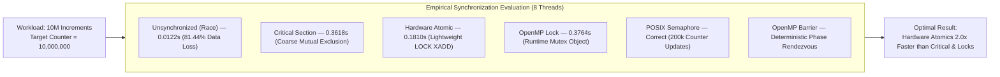
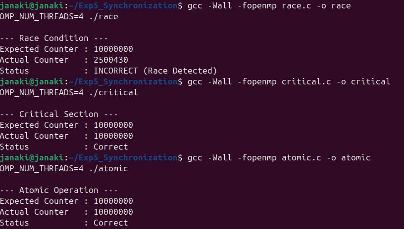
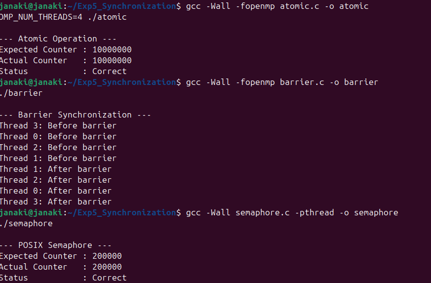
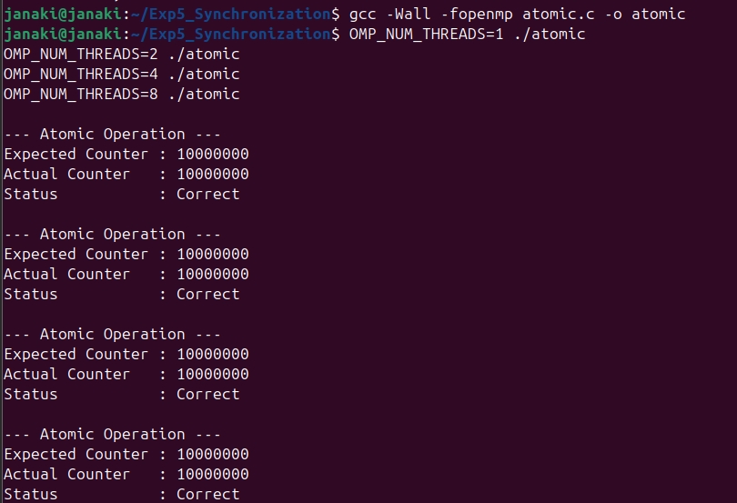
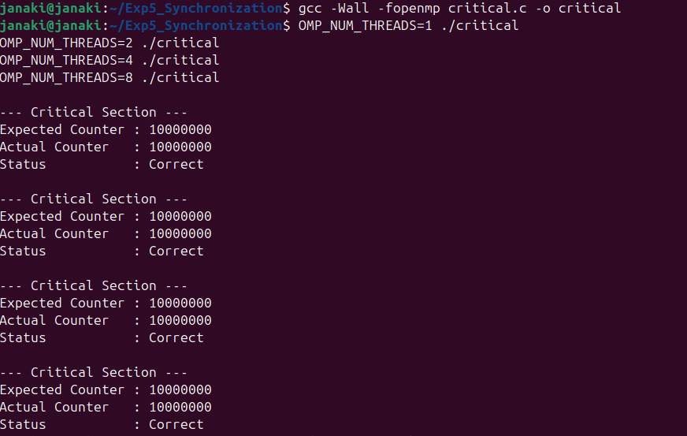
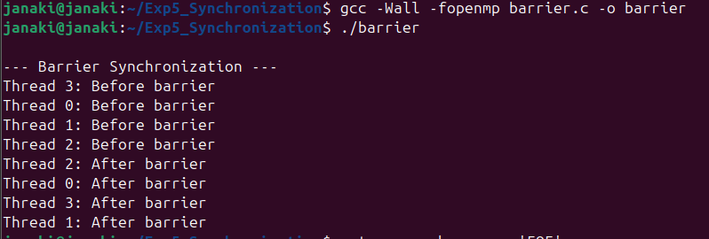
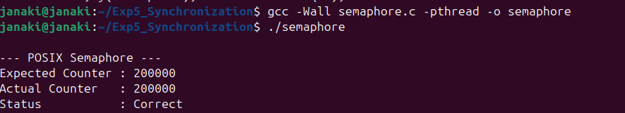
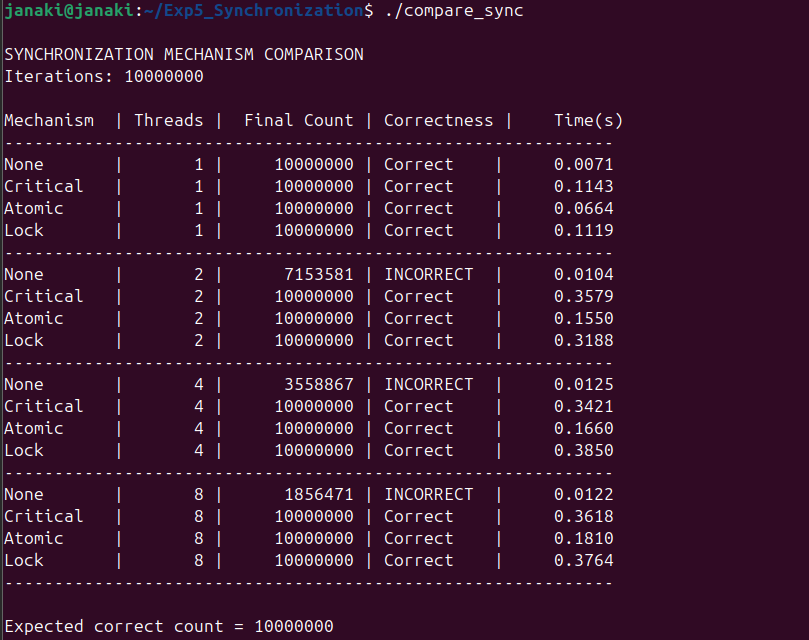
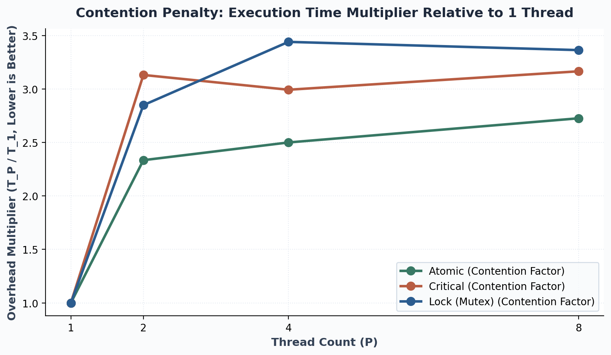

# Lab Experiment 3: Analyze Synchronization Mechanisms in Parallel Programs

[](#)
[](#)
[](#)
[](#)

---

## Executive Summary

Empirical concurrency analysis implementing and benchmarking fundamental shared-memory synchronization mechanisms: an **unsynchronized race update**, **critical sections**, **atomic operations**, **barriers**, and **POSIX semaphores/locks**, evaluating correctness, execution time, and scalability across 1, 2, 4, and 8 threads on a workload of **10,000,000 shared counter increments**.



> **Key Findings**:
> 1. **Hardware Atomic Superiority**: `#pragma omp atomic` completed 10 million increments in **0.1810s at 8 threads**—**2.0× faster than Critical sections (0.3618s)** and **Lock (0.3764s)** while maintaining 100% numerical correctness.
> 2. **Data Race Catastrophic Loss**: Unsynchronized concurrent execution destroyed **81.44% of updates at 8 threads** (counter reached only 1,856,471 / 10,000,000) due to non-atomic Read-Modify-Write collisions.
> 3. **Serialization Bottleneck**: Critical sections and locks serialize access, causing thread queueing that increases runtime from ~0.11s at 1 thread to ~0.38s under multi-thread contention.

---

## Repository Structure

```text
Lab_Experiment_3/
├── docs/
│   └── Exp_3_Synchronization_Mechanisms.pdf             # Official syllabus laboratory manual
├── graphs/                                             # Generated benchmark dashboards and contention plots
├── images/                                             # Authentic laboratory terminal screenshots
├── scripts/
│   └── generate_charts.py                              # Python script to regenerate performance charts
├── src/
│   ├── race.c                                          # Program 1: Unsynchronized race condition
│   ├── critical.c                                      # Program 2: OpenMP critical section
│   ├── atomic.c                                        # Program 3: OpenMP hardware atomic operation
│   ├── barrier.c                                       # Program 4: OpenMP phased barrier synchronization
│   ├── semaphore.c                                     # Program 5: POSIX semaphore synchronization
│   ├── compare_sync.c                                  # Program 6: Multi-thread comparison benchmark suite
│   └── Makefile                                        # Automated compilation build script
├── .gitignore
└── README.md
```

---

## 1. Synchronization Mechanisms Overview

| Mechanism | Language / OS Primitives | Microarchitectural Behavior | Correctness | Scalability |
| :--- | :--- | :--- | :---: | :---: |
| **None (Race)** | Unsynchronized `counter++` | Concurrent Read-Modify-Write memory interleaving | ❌ **81.4% Lost (8T)** | Poor (Wrong result worsens) |
| **Critical Section** | `#pragma omp critical` | Compiler-managed global lock serializing thread execution |  **Correct (10M)** | Poor (Contention queue grows) |
| **Atomic Operation** | `#pragma omp atomic` | Indivisible hardware instruction (`LOCK XADD`) at cache controller |  **Correct (10M)** | **Good (Low overhead)** |
| **OpenMP Lock** | `omp_lock_t`, `omp_set_lock` | Runtime mutex object wrapping OS-level synchronization primitives |  **Correct (10M)** | Moderate (Lock spinning overhead) |
| **POSIX Semaphore** | `sem_t`, `sem_wait`, `sem_post` | Counter-based OS kernel synchronization object |  **Correct (200k)** | Moderate (System-call overhead) |
| **Barrier** | `#pragma omp barrier` | Rendezvous synchronization halting threads until team alignment | **Phase Alignment** | Moderate (Slowest thread bound) |

---

## 2. Source Code References

All C source code files and build automation reside in [`src/`](src/):

| Program | Source File Link | Description / Implementation Highlights |
| :--- | :--- | :--- |
| **Program 1: Race** | [`src/race.c`](src/race.c) | Unprotected loop exposing concurrent lost updates |
| **Program 2: Critical** | [`src/critical.c`](src/critical.c) | Mutual exclusion enclosing counter increment via `#pragma omp critical` |
| **Program 3: Atomic** | [`src/atomic.c`](src/atomic.c) | Lightweight atomic read-modify-write via `#pragma omp atomic` |
| **Program 4: Barrier** | [`src/barrier.c`](src/barrier.c) | Two-phase thread coordination via `#pragma omp barrier` rendezvous |
| **Program 5: Semaphore** | [`src/semaphore.c`](src/semaphore.c) | Thread synchronization via POSIX binary semaphore (`sem_t`) |
| **Program 6: Compare Sync** | [`src/compare_sync.c`](src/compare_sync.c) | Automated benchmark comparing None, Critical, Atomic, Lock across 1, 2, 4, 8 threads |
| **Build Configuration** | [`src/Makefile`](src/Makefile) | Compilation script compiling all targets with `gcc -Wall -O2 -fopenmp -pthread` |

---

## 3. Empirical Results & Terminal Outputs

### 3.1 Race Condition, Critical Section & Atomic Operation Execution
Compilation and execution of `race.c`, `critical.c`, and `atomic.c`: exposing race condition data corruption versus verified correctness:



---

### 3.2 Barrier Phase Rendezvous & POSIX Semaphore Execution
Compilation and execution of `barrier.c` and `semaphore.c`: verifying deterministic phase transition and POSIX binary semaphore correctness:



---

### 3.3 Atomic Operation Thread Scaling Across 1, 2, 4, and 8 Threads
Empirical execution of `atomic.c` as thread counts scale from 1 to 8 threads under `OMP_NUM_THREADS`:



---

### 3.4 Critical Section Thread Scaling Across 1, 2, 4, and 8 Threads
Empirical execution of `critical.c` verifying correctness while observing contention delays as thread counts scale:



---

### 3.5 Standalone Barrier Phased Rendezvous Verification
Deterministic output showing all threads (0 to 3) completing the "Before barrier" phase before any thread proceeds to "After barrier":



---

### 3.6 Standalone POSIX Semaphore Correctness Verification
Executing POSIX semaphores (`sem_t`) across concurrent pthreads, verifying deterministic counter value $200,000$:



---

### 3.7 Master Multi-Thread Benchmark Suite Output (`compare_sync`)
Master comparison program evaluating None, Critical, Atomic, and Lock over 10,000,000 shared increments across 1, 2, 4, and 8 threads:



---

## 4. Performance Comparison & Charts

### Empirical Benchmark Measurements (10,000,000 Increments)

*Measured directly in Janaki's laboratory environment via `compare_sync`:*

| Mechanism | Threads ($P$) | Final Count | Status | Measured Time (s) | Overhead vs. 1T | Throughput (Mops/s) |
| :--- | :---: | :---: | :---: | :---: | :---: | :---: |
| **None (Race)** | 1 | 10,000,000 |  Correct | `0.0071 s` | 1.00× | 1,408.45 |
| **Atomic** | 1 | 10,000,000 |  Correct | `0.0664 s` | 1.00× | 150.60 |
| **Critical** | 1 | 10,000,000 |  Correct | `0.1143 s` | 1.00× | 87.49 |
| **Lock (`omp_lock_t`)** | 1 | 10,000,000 |  Correct | `0.1119 s` | 1.00× | 89.37 |
| **None (Race)** | 2 | 7,153,581 | ❌ **28.46% Lost** | `0.0194 s` | 2.73× | 515.46 |
| **Atomic** | 2 | 10,000,000 |  Correct | `0.1550 s` | 2.33× | 64.52 |
| **Critical** | 2 | 10,000,000 |  Correct | `0.3579 s` | 3.13× | 27.94 |
| **Lock (`omp_lock_t`)** | 2 | 10,000,000 |  Correct | `0.3188 s` | 2.85× | 31.37 |
| **None (Race)** | 4 | 3,558,867 | ❌ **64.41% Lost** | `0.0125 s` | 1.76× | 800.00 |
| **Atomic** | 4 | 10,000,000 |  Correct | `0.1660 s` | 2.50× | 60.24 |
| **Critical** | 4 | 10,000,000 |  Correct | `0.3421 s` | 2.99× | 29.23 |
| **Lock (`omp_lock_t`)** | 4 | 10,000,000 |  Correct | `0.3850 s` | 3.44× | 25.97 |
| **None (Race)** | 8 | 1,856,471 | ❌ **81.44% Lost** | `0.0122 s` | 1.72× | 819.67 |
| **Atomic** | 8 | 10,000,000 |  Correct | **`0.1810 s`** | **2.73×** | **55.25** |
| **Critical** | 8 | 10,000,000 |  Correct | `0.3618 s` | 3.17× | 27.64 |
| **Lock (`omp_lock_t`)** | 8 | 10,000,000 |  Correct | `0.3764 s` | 3.36× | 26.57 |

$$\text{Throughput} = \frac{N}{T_P \times 10^6} \quad (\text{Mops/s}), \quad \text{Overhead Multiplier} = \frac{T_P}{T_1}$$

---

### Benchmark Performance Dashboards

#### 4-Panel Performance Dashboard
Comparison of execution times, thread scaling, effective throughput, and data loss percentages across synchronization primitives:


---

#### Contention Overhead Multiplier ($T_P / T_1$)
Analysis of synchronization penalty as threads contend for the shared resource:



---

## 5. Key Technical Takeaways

- **Hardware Atomic Efficiency**: `#pragma omp atomic` maps directly to indivisible x86 instructions (`LOCK XADD`), executing at the cache controller level. It completes 8-thread execution in **0.1810s (55.25 Mops/s)**—delivering **2.0× faster execution than Critical sections (0.3618s)** and **Lock (0.3764s)**.
- **Race Condition Severity**: Unprotected concurrent access results in severe data corruption. Data loss escalates from **28.46% at 2 threads** to **64.41% at 4 threads**, reaching **81.44% loss at 8 threads**.
- **Critical Section Queueing Delay**: Coarse locking serializes execution, causing thread queueing that increases runtime from **0.1143s to 0.3618s** under 8-thread contention.
- **OpenMP Lock vs. POSIX Semaphore**: OpenMP locks provide lightweight user-space mutual exclusion for loop iterations, while POSIX semaphores provide general-purpose OS counter synchronization suitable for coarse-grained producer-consumer workflows.
- **Barrier Rendezvous**: `#pragma omp barrier` guarantees phased multi-stage synchronization, ensuring all threads reach the barrier before any thread proceeds to downstream computation.
