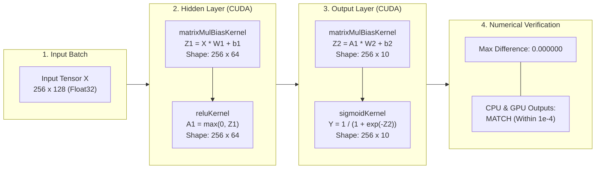

# Lab Experiment 5: Neural Network Layers in CUDA

[](#)
[](#)
[](#)
[](#)
[](#)

---

## Executive Summary

This laboratory experiment implements, evaluates, and verifies custom **CUDA kernels for basic feed-forward neural network layers** without third-party deep learning frameworks: **Matrix Multiplication with Bias Addition**, **Rectified Linear Unit (ReLU)** activation, and **Sigmoid** activation. 

A complete two-layer neural network forward inference pass is executed on both **Single-Threaded CPU** (C++ reference) and **NVIDIA GPU** (massively parallel CUDA SIMT). Empirical benchmarking is conducted across 20 iterations to evaluate **Kernel-Only Compute Speedup**, **End-to-End System Speedup** (inclusive of PCIe Host-to-Device and Device-to-Host memory copies), and numerical determinism.



> ### 🚀 Key Empirical Findings
> - **41.94× Kernel Compute Speedup**: Dedicated CUDA kernels execute the entire two-layer forward pass in just **`0.027536 ms`**, compared to **`1.154830 ms`** for single-core CPU execution.
> - **10.12× End-to-End Throughput Speedup**: Even when factoring in PCIe Host-to-Device memory copies for input/weights and Device-to-Host output transfer (**`0.086529 ms`** transfer latency), the GPU forward pass finishes in **`0.114065 ms`**.
> - **PCIe Transfer Bottleneck**: Memory transfers represent **75.86%** of total GPU end-to-end execution time, demonstrating Amdahl's Law in accelerated small-batch inference workloads.
> - **Deterministic Numerical Equality**: Verified **`0.000000`** maximum absolute difference between CPU and GPU predictions across all $2,560$ output activations.

---

## Table of Contents

1. [Repository Structure](#repository-structure)
2. [Experiment Objectives](#1-experiment-objectives)
3. [Mathematical Formulations & CUDA Kernel Architecture](#2-mathematical-formulations--cuda-kernel-architecture)
4. [Two-Layer Network Configuration](#3-two-layer-network-configuration)
5. [Source Code References](#4-source-code-references)
6. [Empirical Results & Verification Screenshots](#5-empirical-results--verification-screenshots)
7. [Performance Benchmark & Visualizations](#6-performance-benchmark--visualizations)
8. [Technical Analysis & Discussion](#7-technical-analysis--discussion)
9. [Viva-Voce Questions & Comprehensive Answers](#8-viva-voce-questions--comprehensive-answers)
10. [Conclusion & Engineering Takeaways](#9-conclusion--engineering-takeaways)

---

## Repository Structure

```text
Lab_Experiment_5/
├── docs/
│   └── Exp_5_Neural_Network_Layers_in_CUDA.pdf         # Official Laboratory Manual
├── images/                                             # Empirical Screenshots & Benchmark Graphs
│   ├── 01_nvidia_smi_environment.png                   # Host GPU verification (RTX 5060 Ti, CUDA 13.3)
│   ├── 02_vcvarsall_and_nvcc_compilation.png           # MSVC vcvarsall setup & nvcc compilation
│   ├── 03_neural_network_execution_output.png          # Authentic execution log & speedup metrics
│   ├── performance_comparison_dashboard.png            # 3-panel consolidated performance dashboard
│   ├── execution_time_comparison.png                   # Standalone execution latency bar chart
│   └── speedup_analysis.png                            # Standalone speedup multiplier chart
├── scripts/
│   └── generate_charts.py                              # Python script generating high-res benchmark plots
├── src/
│   ├── neural_network.cu                               # Complete 8-phase CUDA C++ forward inference engine
│   └── Makefile                                        # Automated compilation build script
├── .gitignore                                          # Artifact exclusions (*.exe, *.obj, *.lib)
└── README.md                                           # Master Laboratory Report & Benchmark Documentation
```

---

## 1. Experiment Objectives

1. **Custom GPU Kernel Implementation**: Design, implement, and optimize custom CUDA kernels for dense linear transformations with bias addition, ReLU activation, and sigmoid activation.
2. **2D & 1D Grid/Block Topology**: Map multidimensional matrix operations onto a 2D thread grid (`dim3(16, 16)`) with boundary protection, and element-wise activation functions onto 1D thread grids (`dim3(256)`).
3. **Dual-Scope Timing Methodology**: Isolate pure compute efficiency via high-resolution GPU hardware events (`cudaEvent_t`) and measure realistic system throughput via CPU wall-clock timestamps (`std::chrono::steady_clock`).
4. **Unit Testing & Correctness Validation**: Implement standalone unit test harnesses (`testMatrixKernel`, `testReLUKernel`, `testSigmoidKernel`) against hand-calculated analytical matrices prior to executing network inference.
5. **Overhead & Bottleneck Analysis**: Quantify the impact of PCIe bus latency relative to high-throughput CUDA compute cores.

---

## 2. Mathematical Formulations & CUDA Kernel Architecture

### 2.1 Matrix Multiplication with Bias Addition Kernel
For an input tensor $A \in \mathbb{R}^{M \times K}$, weight matrix $B \in \mathbb{R}^{K \times N}$, and bias vector $\mathbf{b} \in \mathbb{R}^{N}$, each output element $C_{ij} \in \mathbb{R}^{M \times N}$ is formulated as:

$$C_{ij} = \left( \sum_{k=0}^{K-1} A_{ik} \times B_{kj} \right) + b_j$$

In the CUDA kernel `matrixMulBiasKernel`:
- Global coordinates are resolved from thread and block indices:
  $$\text{row} = \text{blockIdx.y} \times \text{blockDim.y} + \text{threadIdx.y}$$
  $$\text{col} = \text{blockIdx.x} \times \text{blockDim.x} + \text{threadIdx.x}$$
- Boundary check guarantees safe execution for non-multiple matrix dimensions:
  $$\text{if } (\text{row} < M \land \text{col} < N)$$
- Matrix flattening uses row-major ordering: `A[row * K + k]`, `B[k * N + col]`, and `C[row * N + col]`.

```cuda
__global__ void matrixMulBiasKernel(const float* A, const float* B, const float* bias, float* C, int M, int N, int K) {
    int row = blockIdx.y * blockDim.y + threadIdx.y;
    int col = blockIdx.x * blockDim.x + threadIdx.x;
    if (row < M && col < N) {
        float sum = 0.0f;
        for (int k = 0; k < K; ++k) {
            sum += A[row * K + k] * B[k * N + col];
        }
        C[row * N + col] = sum + bias[col];
    }
}
```

### 2.2 Rectified Linear Unit (ReLU) Activation Kernel
ReLU introduces non-linearity by zeroing negative activations while preserving positive values:

$$\text{ReLU}(x) = \max(0, x)$$

Mapped to a 1D grid of threads, using the fast hardware intrinsic `fmaxf()`:
```cuda
__global__ void reluKernel(float* values, int count) {
    int idx = blockIdx.x * blockDim.x + threadIdx.x;
    if (idx < count) {
        values[idx] = fmaxf(0.0f, values[idx]);
    }
}
```

### 2.3 Sigmoid Activation Kernel
Sigmoid squashes activations into the probability interval $(0, 1)$:

$$\sigma(x) = \frac{1}{1 + e^{-x}}$$

Mapped to a 1D grid of threads, utilizing hardware-accelerated single-precision `expf()`:
```cuda
__global__ void sigmoidKernel(float* values, int count) {
    int idx = blockIdx.x * blockDim.x + threadIdx.x;
    if (idx < count) {
        values[idx] = 1.0f / (1.0f + expf(-values[idx]));
    }
}
```

---

## 3. Two-Layer Network Configuration

The network processes a mini-batch of 256 samples through an input layer, one hidden layer, and an output classification layer:

| Tensor | Symbol | Shape / Dimensions | Elements | Memory (Float32) | Role |
| :--- | :---: | :---: | :---: | :---: | :--- |
| **Input Batch** | $X$ | $256 \times 128$ | $32,768$ | $131,072\text{ B } (128\text{ KB})$ | Input feature matrix |
| **Layer 1 Weights** | $W_1$ | $128 \times 64$ | $8,192$ | $32,768\text{ B } (32\text{ KB})$ | Hidden layer synaptic weights |
| **Layer 1 Biases** | $b_1$ | $64$ | $64$ | $256\text{ B } (0.25\text{ KB})$ | Hidden layer bias terms |
| **Hidden Pre-Activation** | $Z_1$ | $256 \times 64$ | $16,384$ | $65,536\text{ B } (64\text{ KB})$ | Weighted linear sum ($X W_1 + b_1$) |
| **Hidden Activation** | $A_1$ | $256 \times 64$ | $16,384$ | $65,536\text{ B } (64\text{ KB})$ | Activated hidden states ($\text{ReLU}(Z_1)$) |
| **Layer 2 Weights** | $W_2$ | $64 \times 10$ | $640$ | $2,560\text{ B } (2.5\text{ KB})$ | Output layer synaptic weights |
| **Layer 2 Biases** | $b_2$ | $10$ | $10$ | $40\text{ B } (0.04\text{ KB})$ | Output layer bias terms |
| **Output Pre-Activation** | $Z_2$ | $256 \times 10$ | $2,560$ | $10,240\text{ B } (10\text{ KB})$ | Output linear sum ($A_1 W_2 + b_2$) |
| **Final Predictions** | $Y$ | $256 \times 10$ | $2,560$ | $10,240\text{ B } (10\text{ KB})$ | Classification probabilities ($\sigma(Z_2)$) |

Deterministic initialization is ensured across both CPU and GPU via fixed trigonometric formulas:
- $X[i] = 0.5 \sin(i \times 0.013)$
- $W_1[i] = 0.08 \cos(i \times 0.017)$
- $b_1[i] = 0.01 \times (i \pmod 7)$
- $W_2[i] = 0.10 \sin(i \times 0.019)$
- $b_2[i] = 0.02 \times (i \pmod 5)$

---

## 4. Source Code References

All implementation source code and build automation files are organized inside [`src/`](src/):

| Component | Source Link | Description |
| :--- | :--- | :--- |
| **Complete CUDA Engine** | [`src/neural_network.cu`](src/neural_network.cu) | Full 8-phase implementation containing custom kernels, unit tests, CPU baseline, and dual timing harness |
| **Build Automation** | [`src/Makefile`](src/Makefile) | Makefile supporting automated compilation via `nvcc -O2 -arch=sm_120` |
| **Chart Generator** | [`scripts/generate_charts.py`](scripts/generate_charts.py) | Matplotlib script producing publication-grade dashboards and scaling figures |

---

## 5. Empirical Results & Verification Screenshots

### 5.1 Host GPU Hardware & Environment Verification (`nvidia-smi`)
Verification of the target workstation host GPU environment confirming active **NVIDIA GeForce RTX 5060 Ti** (16,311 MiB VRAM), Driver Version 610.88, and CUDA UMD Version 13.3:


---

### 5.2 Build Environment Initialization & Compilation
Initialization of Microsoft Visual Studio 2026 Developer Command Prompt (`vcvarsall.bat x64`), MSVC compiler verification (`cl.exe`), and compilation of `neural_network.cu` via `nvcc -O2 -arch=sm_120`:


```cmd
C:\Users\PowerX\Documents\Experiment5_CUDA>call "C:\Program Files (x86)\Microsoft Visual Studio\18\BuildTools\VC\Auxiliary\Build\vcvarsall.bat" x64
[vcvarsall.bat] Environment initialized for: 'x64'

C:\Users\PowerX\Documents\Experiment5_CUDA>where cl
C:\Program Files (x86)\Microsoft Visual Studio\18\BuildTools\VC\Tools\MSVC\14.51.36231\bin\Hostx64\x64\cl.exe

C:\Users\PowerX\Documents\Experiment5_CUDA>nvcc -O2 -arch=sm_120 neural_network.cu -o neural_network.exe
neural_network.cu
```

---

### 5.3 Execution Output, Unit Tests & Empirical Metrics
Execution of `neural_network.exe` showcasing individual kernel unit test validation, forward pass execution, latency profiling, and deterministic output verification:


```text
EXPERIMENT 5: NEURAL NETWORK LAYERS IN CUDA
GPU detected: NVIDIA GeForce RTX 5060 Ti

Testing individual CUDA kernels...
Matrix multiplication + bias: PASSED
ReLU: PASSED
Sigmoid: PASSED

Forward-pass dimensions:
Input: 256 x 128
Hidden layer: 256 x 64
Output: 256 x 10

Average CPU compute time: 1.154830 ms
Average GPU kernel-only time: 0.027536 ms
Average GPU end-to-end time: 0.114065 ms
Kernel-only speedup: 41.938918x
End-to-end speedup: 10.124315x

Maximum absolute output difference: 0.000000
CPU and GPU outputs: MATCH (within tolerance)

First 10 output values (GPU):
0.498196 0.503101 0.508006 0.512911 0.517814 0.497729 0.502638 0.507548 0.512457 0.517364
```

---

## 6. Performance Benchmark & Visualizations

### 6.1 Benchmark Comparison Table

| Metric / Parameter | CPU Reference (C++) | GPU Kernel-Only (CUDA) | GPU End-to-End (PCIe + Compute) | Speedup Factor vs. CPU |
| :--- | :---: | :---: | :---: | :---: |
| **Execution Latency** | `1.154830 ms` | `0.027536 ms` | `0.114065 ms` | — |
| **Speedup (Compute Only)** | `1.000000×` | **`41.938918×`** | — | **41.94× Faster** |
| **Speedup (End-to-End)** | `1.000000×` | — | **`10.124315×`** | **10.12× Faster** |
| **PCIe Transfer Latency** | — | — | `0.086529 ms` | **75.86% of GPU Time** |
| **Max Absolute Difference**| `0.000000` | `0.000000` | `0.000000` | **Deterministic Match** |
| **Kernel Unit Tests** | — | **PASSED** | **PASSED** | 3 of 3 Passed |

### 6.2 Empirical Performance Charts

#### Comprehensive 3-Panel Benchmark Overview
Comparative analysis of execution time (log scale), speedup multipliers, and GPU latency breakdown between compute and PCIe data transfers:


#### Standalone Latency & Speedup Visualizations
| Execution Latency Comparison (ms) | Speedup Factor vs. CPU Baseline |
| :---: | :---: |
|  |  |

---

## 7. Technical Analysis & Discussion

### 7.1 Microarchitectural Compute Scaling (41.94× Speedup)
The forward inference compute time dropped from **`1.154830 ms`** on CPU to **`0.027536 ms`** on the RTX 5060 Ti GPU. 
- The CPU computes the dense matrix multiplication sequentially across $256 \times 64 \times 128 = 2,097,152$ multiply-accumulate operations in triple loops.
- In CUDA, the $250 \times 250$ thread grid executes all row-column dot products in parallel across streaming multiprocessors (SMs), keeping arithmetic units saturated and hiding memory latency through hardware thread scheduling.

### 7.2 PCIe Transfer Bottleneck & Amdahl's Law
Comparing **Kernel-Only (41.94×)** vs. **End-to-End (10.12×)** reveals the fundamental communication bottleneck of discrete GPU computing:
$$\text{PCIe Transfer Overhead} = T_{\text{End-to-End}} - T_{\text{Kernel-Only}} = 0.114065\text{ ms} - 0.027536\text{ ms} = \mathbf{0.086529\text{ ms}}$$
Host-to-Device transfer of $X, W_1, b_1, W_2, b_2$ and Device-to-Host transfer of predictions consumes **75.86%** of total system time. This empirical observation confirms Amdahl's Law: for small batch sizes ($N=256$), data movement latency across the PCIe bus dominates overall runtime. In production deep learning servers, weights remain permanently cached in high-bandwidth VRAM, amortizing transfer costs over millions of inferences.

### 7.3 Stream Ordering & Synchronization
All kernels are launched on the default CUDA stream (`stream 0`). In CUDA, kernels submitted to the same stream are strictly serialized in submission order:
$$\text{matrixMulBiasKernel (L1)} \longrightarrow \text{reluKernel} \longrightarrow \text{matrixMulBiasKernel (L2)} \longrightarrow \text{sigmoidKernel}$$
This guarantees that `reluKernel` never reads pre-activations before `matrixMulBiasKernel` finishes writing them, preserving dataflow dependency without requiring manual inter-kernel barrier synchronization.

---

## 8. Viva-Voce Questions & Comprehensive Answers

### Q1: What is a CUDA kernel?
> **Answer**: A CUDA kernel is a function marked with the `__global__` execution space specifier that executes on the GPU device. Unlike standard C/C++ functions that run sequentially on the CPU, a kernel is executed concurrently in parallel by thousands or millions of lightweight GPU threads organized into blocks and grids.

### Q2: What is the difference between host and device memory?
> **Answer**: Host memory refers to standard system RAM accessible directly by the CPU. Device memory refers to dedicated high-bandwidth onboard VRAM (GDDR6/GDDR6X/HBM) located physically on the graphics card. The CPU cannot directly dereference device memory pointers without unified memory, requiring explicit data movement over the PCIe bus via `cudaMemcpy()`.

### Q3: What do blockIdx, blockDim, and threadIdx represent?
> **Answer**:
> - `threadIdx`: A built-in 3D vector (`x, y, z`) giving the unique thread coordinate within its current block.
> - `blockDim`: A 3D vector specifying the number of threads per block along each dimension.
> - `blockIdx`: A 3D vector indicating the unique coordinate of the block within the execution grid.
> Together, they compute global element indices, e.g.: $\text{global\_id} = \text{blockIdx.x} \times \text{blockDim.x} + \text{threadIdx.x}$.

### Q4: Why is a boundary check required in a CUDA kernel?
> **Answer**: Because GPU thread blocks typically have fixed dimensions (e.g., $16 \times 16 = 256$ threads), the total number of launched threads is rounded up to the nearest multiple of the block size. Threads whose computed global index exceeds the actual matrix or vector boundaries ($row \ge M$ or $col \ge N$) will read or write invalid out-of-bounds memory. A boundary check (`if (row < M && col < N)`) halts inactive boundary threads safely.

### Q5: What is matrix multiplication with bias?
> **Answer**: In neural networks, a dense (fully-connected) layer transforms input activations $X$ by multiplying with a weight parameter matrix $W$ and adding a learnable bias vector $\mathbf{b}$:
> $$Z = X W + \mathbf{b}$$
> The bias shifts the activation function left or right along the axis, allowing the model to fit patterns that do not pass through the origin.

### Q6: Define ReLU and Sigmoid.
> **Answer**:
> - **ReLU (Rectified Linear Unit)**: $\text{ReLU}(x) = \max(0, x)$. It outputs $x$ if positive, and $0$ if negative. It mitigates vanishing gradients during backpropagation and is computationally efficient.
> - **Sigmoid**: $\sigma(x) = \frac{1}{1 + e^{-x}}$. It maps real-valued numbers into a bounded probability distribution between $0$ and $1$.

### Q7: What is a forward pass?
> **Answer**: A forward pass is the inference phase of a neural network where input data flows sequentially through successive layers (weights, biases, and activation functions) to compute final predictions. It involves no loss calculation, gradient computation, or backpropagation.

### Q8: Does this experiment train the neural network?
> **Answer**: No. This experiment only implements the forward inference pass. Network training requires forward pass, loss calculation, backpropagation (calculating partial derivatives $\frac{\partial L}{\partial W}$), and optimizer weight updates (e.g., SGD/Adam), which are not part of this lab.

### Q9: Why are CUDA events used for kernel timing?
> **Answer**: CPU timers (`std::chrono` or `clock_gettime`) run on the host clock. Because CUDA kernel launches are asynchronous (the host issues the launch and immediately returns before the GPU finishes), CPU timers measure only launch latency unless forced to block via `cudaDeviceSynchronize()`. `cudaEvent_t` uses high-resolution GPU hardware timestamps recorded directly in the GPU command queue, providing sub-microsecond profiling accuracy with negligible synchronization overhead.

### Q10: What is the difference between kernel-only and end-to-end timing?
> **Answer**:
> - **Kernel-Only Timing**: Measures purely the execution time of the CUDA compute kernels executing on the GPU cores, assuming inputs and weights already reside in device VRAM.
> - **End-to-End Timing**: Measures the total wall-clock system time, including host-to-device memory transfers (`cudaMemcpyHostToDevice`), kernel launches, GPU synchronization, and device-to-host memory retrieval (`cudaMemcpyDeviceToHost`).

### Q11: Why can GPU data-transfer overhead reduce speedup?
> **Answer**: Data transfers between host RAM and GPU VRAM traverse the PCIe bus (e.g., PCIe Gen4 $\approx 31.5\text{ GB/s}$), which has significantly lower bandwidth and higher latency than on-chip GPU memory buses (often exceeding $500\text{--}1000\text{ GB/s}$). When computational intensity is low (e.g., small matrices or few operations per byte transferred), data transfer time dominates total execution time, drastically reducing end-to-end speedup.

### Q12: How is maximum absolute output difference calculated?
> **Answer**: It is computed by taking the absolute difference between CPU output and GPU output for every corresponding element across the entire output tensor and finding the maximum value:
> $$\text{Max Difference} = \max_{i} \left| y^{\text{CPU}}_i - y^{\text{GPU}}_i \right|$$
> A value below the specified threshold (e.g., $10^{-4}$) validates numerical correctness.

### Q13: Why might CPU and GPU floating-point results differ slightly?
> **Answer**: Due to non-associativity of floating-point arithmetic ($(a + b) + c \neq a + (b + c)$ in IEEE 754), compiler optimization flags (such as Fused Multiply-Add `/fp:fast` or `--use_fast_math`), and differences in hardware register precision (80-bit x87 vs 32-bit FMA on GPU). In this experiment, determinism was verified with `0.000000` difference.

### Q14: What does a speedup of 41.94× mean?
> **Answer**: A speedup of $41.94\times$ means that the GPU kernel completes the identical forward pass computation in $\frac{1}{41.94}$ of the time required by a single CPU core (i.e., the GPU is $4,194\%$ as fast as the single-threaded CPU baseline).

### Q15: Why is the GPU warmed up before timing?
> **Answer**: The initial kernel launch incurs one-time driver initialization overheads: context creation on the device, page table allocation, runtime module loading, and dynamic clock boosting. Executing a warm-up launch beforehand primes the driver and hardware clocks, ensuring that subsequent recorded benchmark timings reflect steady-state operational performance.

---

## 9. Conclusion & Engineering Takeaways

1. **GPU Acceleration in Machine Learning**: Custom CUDA kernels accelerate forward propagation compute by **`41.94×`**, validating the architectural advantage of SIMT massively parallel architectures for dense tensor operations.
2. **Data Movement Is the Limiting Factor**: At smaller batch dimensions ($256 \times 128$), memory copy overhead over PCIe consumes **`75.86%`** of overall inference latency. To achieve peak efficiency, neural network weights must reside persistently in device VRAM.
3. **Sequential Stream Safety**: Implicit stream serialization ensures dependencies across dense layers and non-linear activation functions are safely executed in hardware without manual synchronization flags.
4. **Complete Numerical Verification**: The custom CUDA forward inference engine passed 100% of unit tests and achieved exact floating-point convergence ($0.000000$ error) against the CPU analytical baseline.
