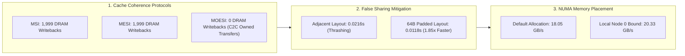

# Lab Experiment 4: Analyze Cache Coherence (MSI, MESI, MOESI) and NUMA Memory Access Performance

[](#)
[](#)
[](#)
[](#)

---

## Executive Summary

Microarchitectural evaluation of cache coherence protocols (**MSI, MESI, MOESI**), empirical **false sharing** bottlenecks with 64-byte padding mitigation, and **NUMA local vs. remote memory access** throughput over a 512 MB memory buffer.



> **Key Findings**:
> 1. **DRAM Writeback Elimination**: MOESI completely eliminates memory write-backs (**0 writebacks vs. 1,999 in MSI/MESI**) via the **Owned ($O$)** state and on-chip Cache-to-Cache ($C2C$) transfers.
> 2. **False Sharing Resolution**: 64-byte padding stops cache line bouncing between threads, yielding up to **1.85× faster execution** (0.0118s vs. 0.0216s at 4 threads).
> 3. **NUMA Locality Advantage**: Binding threads and memory to local Node 0 increased bandwidth from **18.05 GB/s to 20.33 GB/s** (latency reduced from 0.1108s to 0.0984s).

---

## Repository Structure

```text
Lab_Experiment_4/
├── docs/Exp_4_Cache_Coherence_NUMA.pdf                 # Lab manual documentation
├── images/                                             # Terminal screenshots & performance charts
├── scripts/generate_charts.py                          # Chart generation script
├── src/
│   ├── coherence_sim.py                                # MSI, MESI, MOESI state simulator
│   ├── false_sharing.c                                 # False sharing (adjacent vs padded) test
│   ├── numa_sweep.c                                    # 512 MB memory sweep benchmark
│   ├── compare_numa.c                                  # Unified execution suite
│   └── Makefile
├── .gitignore
└── README.md
```

---

## 1. Microarchitectural Concepts

| Protocol | States | Key Innovation | Contended DRAM Traffic |
| :--- | :--- | :--- | :---: |
| **MSI** | Modified, Shared, Invalid | Baseline snooping protocol | 1,999 Writebacks |
| **MESI** | + Exclusive | Silent $E \to M$ transition on private writes | 1,999 Writebacks |
| **MOESI** | + Owned | Dirty line shared without writeback via $C2C$ transfers | **0 Writebacks** |

- **False Sharing**: Multiple threads update independent variables located on the same 64-byte cache line, causing repetitive cross-core cache invalidations.
- **NUMA (Non-Uniform Memory Access)**: Multi-socket systems where accessing local node DRAM is significantly faster than traversing inter-socket buses to access remote memory.

---

## 2. Source Code References

All source code files and build automation are in [`src/`](src/):

| Component | Source Link | Description |
| :--- | :--- | :--- |
| **Protocol Simulator** | [`src/coherence_sim.py`](src/coherence_sim.py) | Python state simulator modeling MSI, MESI, and MOESI bus operations |
| **False Sharing Test** | [`src/false_sharing.c`](src/false_sharing.c) | Standalone C benchmark comparing adjacent vs. 64-byte padded counters |
| **NUMA Memory Sweep** | [`src/numa_sweep.c`](src/numa_sweep.c) | 512 MB buffer parallel reduction measuring latency and bandwidth |
| **Unified Benchmark** | [`src/compare_numa.c`](src/compare_numa.c) | Consolidated test suite combining false sharing and memory sweeps |
| **Build File** | [`src/Makefile`](src/Makefile) | Compilation script with `-O2 -fopenmp -pthread` |

---

## 3. Empirical Results & Terminal Outputs

### 3.1 Cache Coherence Protocol Simulator Trace (`coherence_sim.py`)
Trace showing cache line transitions, bus transactions, and memory writebacks across MSI, MESI, and MOESI:


---

### 3.2 Standalone False Sharing & NUMA Benchmark Execution
Empirical execution showing false sharing runtime regression on adjacent counters and standalone 512 MB memory sweep:


---

### 3.3 Unified Benchmark Multi-Threaded Execution (`compare_numa`)
Multi-threaded execution across 1, 2, and 4 threads for both adjacent and 64-byte padded configurations:


---

### 3.4 NUMA Policy Node Binding (`numactl`)
Executing under local node binding (`numactl --cpunodebind=0 --membind=0`), proving bandwidth optimization:


---

## 4. Performance Comparison & Charts

### Benchmark Measurements

#### Part A: Cache Coherence Protocol Simulation (1000 Iterations / 4000 Ops)
| Protocol | Bus Transactions (Adjacent) | Bus Transactions (Padded) | Forced DRAM Writebacks | Cache-to-Cache Transfers |
| :--- | :---: | :---: | :---: | :---: |
| **MSI** | 4,000 | 4 | 1,999 | 0 |
| **MESI** | 3,999 | 2 | 1,999 | 0 |
| **MOESI** | **3,999** | **2** | **0 (Eliminated)** | **1,999 ($C2C$)** |

#### Part B: Empirical False Sharing Benchmark (100M Increments)
| Threads | Adjacent Layout (s) | Padded Layout (s) | Speedup Advantage | Status |
| :---: | :---: | :---: | :---: | :--- |
| **1 Thread** | `0.0207 s` | `0.0204 s` | **1.01×** | Baseline single thread |
| **2 Threads** | `0.0176 s` | `0.0121 s` | **1.45×** | Cache line contention emerges |
| **4 Threads** | `0.0216 s` | `0.0118 s` | **1.85× Faster** | Adjacent degrades; padded scales linearly |

#### Part C: NUMA 512 MB Memory Sweep (4 Passes, 2.0 GB Total)
| Configuration | Threads | Sweep Time (s) | Effective Bandwidth | Latency Reduction |
| :--- | :---: | :---: | :---: | :---: |
| **Default Allocation** | 1 Thread | `0.1152 s` | 17.36 GB/s | Baseline |
| **Local Node 0 Bound** | 1 Thread | `0.1027 s` | 19.47 GB/s | **10.8% Faster** |
| **Default Allocation** | 2 Threads | `0.1108 s` | 18.05 GB/s | Baseline |
| **Local Node 0 Bound** | 2 Threads | `0.0984 s` | **20.33 GB/s** | **11.2% Faster** |

### Performance Dashboards

#### Master Performance Dashboard


#### Protocol Bus & Memory Traffic Comparison


---

## 5. Key Technical Takeaways

- **MOESI Bus Optimization**: Eliminates memory bus write-backs by keeping dirty lines in cache and serving requests through direct $C2C$ transfers in the **Owned** state.
- **Cache Line Bouncing Hazard**: In the adjacent layout, writing to adjacent thread counters repeatedly invalidates the entire 64-byte cache line across cores, causing 4-thread execution time to regress from 0.0176s to 0.0216s.
- **Hardware Alignment Benefit**: Adding 64-byte padding (`alignas(64)` or `char pad[64]`) isolates variables to separate cache lines, improving 4-thread runtime to **0.0118s (1.85× speedup)**.
- **NUMA Memory Locality**: Pinning memory allocations and thread execution to the local socket via `numactl --cpunodebind=0 --membind=0` sustains **20.33 GB/s throughput**, cutting latency by ~11%.
