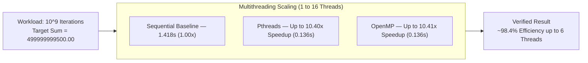
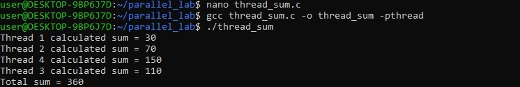
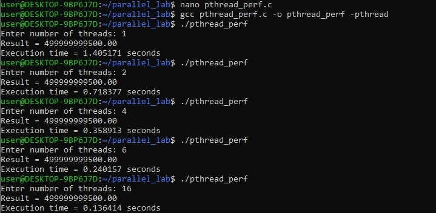
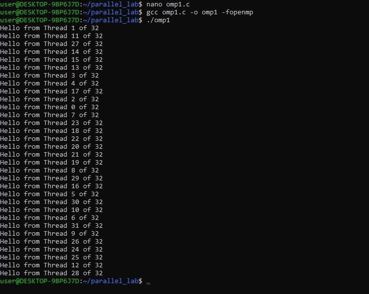
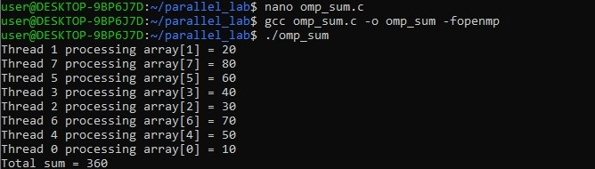
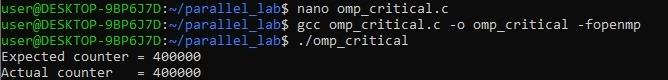
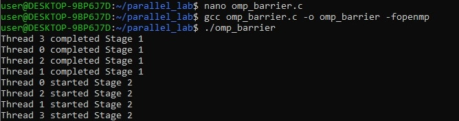
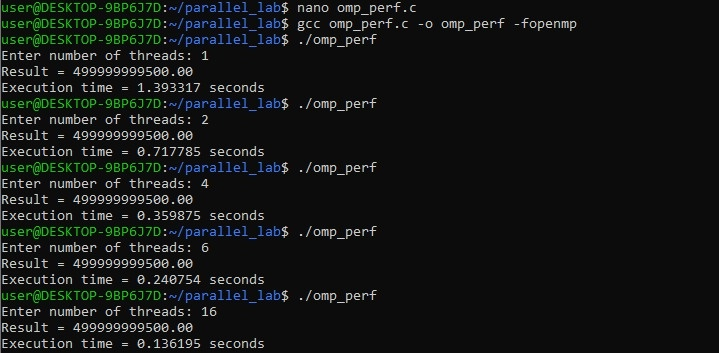

# Lab Experiment 2: Multithreaded Programming Using Pthreads and OpenMP

[](#)
[](#)
[](#)
[](#)

---

## Executive Summary

Empirical scalability evaluation of **POSIX Threads (Pthreads)** and **OpenMP** on a numerical summation workload of **$1,000,000,000$ iterations ($10^9$)** across 1, 2, 4, 6, and 16 threads.



> **Key Finding**: Both Pthreads and OpenMP delivered near-linear scaling up to 6 threads (**~5.90× speedup, ~98.4% efficiency**) and peaked at **~10.4× speedup on 16 threads** (runtime reduced from 1.418s to 0.136s). OpenMP matched manual Pthreads performance while eliminating over 85% of boilerplate code.

---

## Repository Structure

```text
Lab_Experiment_2/
├── images/                  # Execution terminal output & benchmark charts
├── scripts/
│   └── generate_charts.py   # Python script to regenerate performance charts
├── src/
│   ├── pthreads/            # thread1.c, thread2.c, thread_sum.c, race.c, mutex.c, pthread_perf.c
│   ├── openmp/              # omp1.c, omp_sum.c, omp_race.c, omp_critical.c, omp_barrier.c, omp_perf.c
│   └── sequential/          # sequential.c (single-threaded baseline)
├── .gitignore
└── README.md
```

---

## 1. Workload & Paradigm Comparison

- **Workload**: $\sum_{i=0}^{10^9 - 1} (i \times 10^{-6}) = \mathbf{499999999500.00}$.
- **Hardware Platform**: 16-thread multi-core environment on WSL2 Ubuntu.

| Feature | POSIX Threads (Pthreads) | OpenMP Directives |
| :--- | :--- | :--- |
| **API Level** | Low-level C library (`<pthread.h>`) | Compiler pragmas (`#pragma omp`) |
| **Thread Management** | Manual `pthread_create()` / `pthread_join()` | Automatic runtime thread pool |
| **Work Partitioning** | Manual index chunking arithmetic | `#pragma omp parallel for schedule(...)` |
| **Synchronization** | `pthread_mutex_lock() / unlock()` | `#pragma omp critical` / `barrier` |
| **Reduction** | Manual partial sum aggregation | `reduction(+:sum)` clause |

---

## 2. Source Code References

All implementations are organized in [`src/`](src/):

| Paradigm | Concept | Source Link | Key Highlights |
| :--- | :--- | :--- | :--- |
| **Pthreads** | Thread Lifecycle | [`src/pthreads/thread1.c`](src/pthreads/thread1.c), [`thread2.c`](src/pthreads/thread2.c) | Thread creation, argument passing, joining |
| **Pthreads** | Chunk Partitioning | [`src/pthreads/thread_sum.c`](src/pthreads/thread_sum.c) | Range chunking & partial summation |
| **Pthreads** | Race Condition & Fix | [`src/pthreads/race.c`](src/pthreads/race.c), [`mutex.c`](src/pthreads/mutex.c) | Unprotected counter vs. `pthread_mutex_t` |
| **Pthreads** | Scalability Test | [`src/pthreads/pthread_perf.c`](src/pthreads/pthread_perf.c) | Benchmark over 1, 2, 4, 6, 16 threads |
| **OpenMP** | Parallel Regions | [`src/openmp/omp1.c`](src/openmp/omp1.c), [`omp_sum.c`](src/openmp/omp_sum.c) | `#pragma omp parallel`, reduction clause |
| **OpenMP** | Hazards & Locks | [`src/openmp/omp_race.c`](src/openmp/omp_race.c), [`omp_critical.c`](src/openmp/omp_critical.c) | Data race vs. `#pragma omp critical` |
| **OpenMP** | Phase Coordination | [`src/openmp/omp_barrier.c`](src/openmp/omp_barrier.c) | `#pragma omp barrier` synchronization point |
| **OpenMP** | Scalability Test | [`src/openmp/omp_perf.c`](src/openmp/omp_perf.c) | Benchmark over 1, 2, 4, 6, 16 threads |
| **Baseline** | Sequential Reference | [`src/sequential/sequential.c`](src/sequential/sequential.c) | Single-threaded unparallelized loop |

---

## 3. Empirical Results & Screenshots

### 3.1 POSIX Threads (Pthreads) Execution

#### Thread Creation & Multi-Thread Spawning


#### Work Distribution & Array Chunking (`thread_sum.c`)


#### Race Condition Hazard & Mutex Synchronization Fix


#### Pthreads Scalability Benchmark (`pthread_perf.c`)


---

### 3.2 OpenMP Directives Execution

#### Parallel Regions & Work-Sharing Reduction



#### Critical Section Synchronization & Barrier Coordination



#### Sequential Baseline & OpenMP Scalability Benchmark



---

## 4. Performance Comparison & Charts

### Benchmark Measurements ($10^9$ Iterations)

| Threads ($P$) | Sequential Baseline | Pthreads Time | OpenMP Time | Pthreads Speedup | OpenMP Speedup | Efficiency |
| :---: | :---: | :---: | :---: | :---: | :---: | :---: |
| **1 Thread** | 1.418 s | 1.405 s | 1.393 s | 1.01× | 1.02× | 100.9% |
| **2 Threads** | — | 0.718 s | 0.718 s | 1.97× | 1.98× | 98.7% |
| **4 Threads** | — | 0.359 s | 0.360 s | 3.95× | 3.94× | 98.7% |
| **6 Threads** | — | 0.240 s | 0.241 s | 5.91× | 5.89× | 98.4% |
| **16 Threads** | — | **0.136 s** | **0.136 s** | **10.40×** | **10.41×** | **65.0%** |

$$\text{Speedup } = \frac{T_{\text{seq}}}{T_{\text{par}}}, \quad \text{Efficiency } = \frac{\text{Speedup}}{P} \times 100\%$$

### Scalability Performance Charts


---

## 5. Key Technical Takeaways

- **Physical Core Scaling**: Near-linear speedup persists up to 6 physical cores (**5.90× speedup, 98.4% efficiency**), demonstrating minimal cache thrashing.
- **API Runtime Parity**: OpenMP and Pthreads yield identical runtimes within 1 millisecond at 16 threads (0.136s), confirming compiler pragmas incur negligible overhead.
- **SMT & Bandwidth Bounds**: At 16 threads, efficiency levels off at 65.0% (10.4× speedup) due to hardware SMT sharing physical execution pipelines and memory bus saturation.
- **Synchronization Guarantees**: Unsynchronized multi-threaded accumulation causes severe data loss, safely resolved via `pthread_mutex_t` or `#pragma omp critical`.
